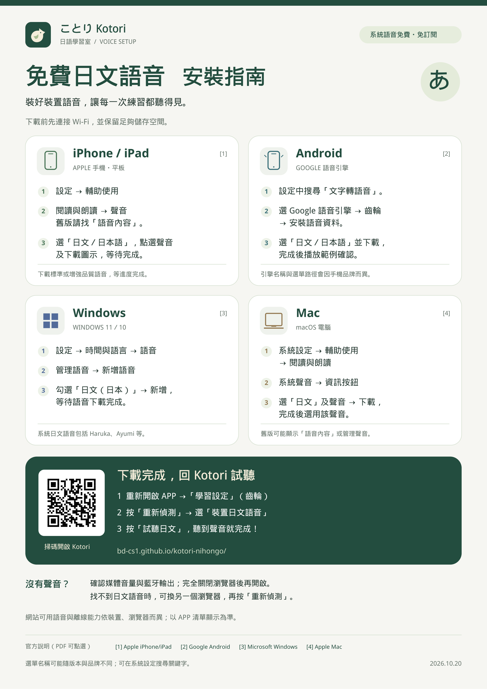

# 免費日文語音安裝指南

Kotori 日語學習室的 A4 直式安裝說明圖卡，包含 iPhone／iPad、Android、Windows、Mac 的日文語音下載方法，以及回到 APP 重新偵測與試聽的步驟。

- [下載 PDF 列印版](Kotori_Japanese_Voice_Install_A4.pdf)：A4（210 × 297 mm），建議以 100% 比例列印。
- [下載 PNG 圖卡](Kotori_Japanese_Voice_Install_A4.png)：2480 × 3508 像素，300 dpi。
- [開啟 Kotori APP](https://bd-cs1.github.io/kotori-nihongo/)；圖卡上的 QR Code 也會開啟這個網址。

圖卡資料查核日期：2026-10-20。系統選單名稱可能隨版本與裝置品牌不同；可供網站使用的語音與離線能力，以裝置、瀏覽器及 APP 實際顯示的語音清單為準。PDF 內附官方說明連結。

